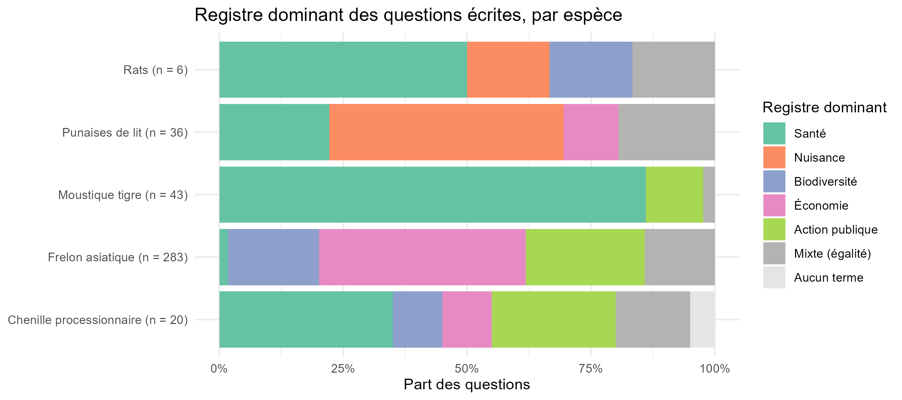
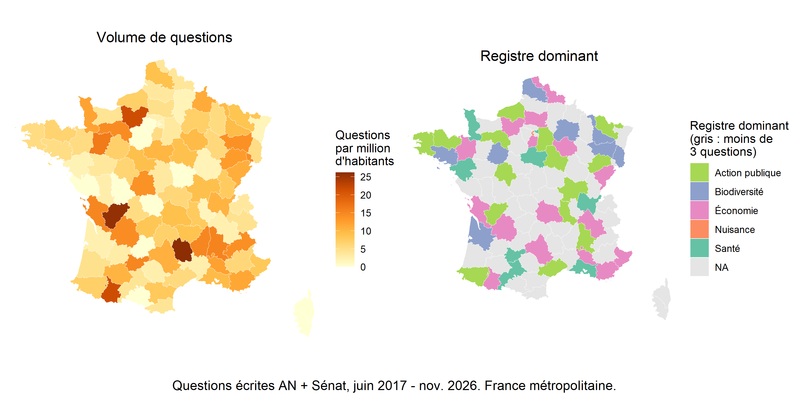
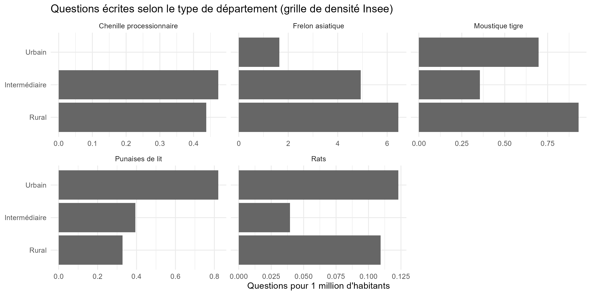

# Espèces « indésirables » dans les questions écrites parlementaires (2017-2026)

Comment les députés et les sénateurs parlent-ils du moustique tigre, du frelon asiatique, des punaises de lit, de la chenille processionnaire et des rats quand ils interpellent le gouvernement ? Et ces discours changent-ils selon le territoire de l'élu ?

Mini-projet réalisé en novembre 2026 pour m'exercer à l'analyse de données textuelles en R. Tout le traitement est reproductible à partir des données ouvertes de l'Assemblée nationale, du Sénat et de l'Insee.

## Résultats en bref

Le corpus compte **388 questions écrites** (283 à l'Assemblée, 105 au Sénat), publiées entre le 21 juin 2017 et novembre 2026.

- Le frelon asiatique domine largement (283 questions). Le rat urbain est presque absent (6 questions).
- Chaque espèce a son propre registre. Le moustique tigre est traité comme un problème de santé (86 % des questions : dengue, chikungunya, vecteur). Les punaises de lit relèvent surtout de la nuisance et du logement. Le frelon est d'abord un problème économique pour la filière apicole.
- Rapportées à la population, les questions sur le frelon viennent surtout des départements ruraux (6,5 pour un million d'habitants contre 1,6 dans les départements urbains). Celles sur les punaises de lit viennent surtout des départements urbains (0,8 contre 0,3).
- Les punaises de lit connaissent un pic net en 2023, l'année de la médiatisation des infestations à Paris.







Les deux autres figures montrent l'évolution annuelle (`fig1_evolution.png`) et les mots les plus spécifiques de chaque espèce (`fig2_mots_specifiques.png`).

## Données

| Source | Contenu | Utilisation |
|---|---|---|
| [data.assemblee-nationale.fr](https://data.assemblee-nationale.fr) | Questions écrites des 15e, 16e et 17e législatures (JSON) et fichier des mandats des députés | Texte, date, département de l'auteur |
| [data.senat.fr](https://data.senat.fr/la-base-questions/) | Base « Questions » (dump PostgreSQL) | Texte, date, département de l'auteur |
| [Insee, COG 2025](https://www.insee.fr/fr/information/8377162) | Liste officielle des départements | Codes et noms harmonisés |
| [Insee, grille de densité 2025](https://www.insee.fr/fr/information/8571524) | Typologie des départements (rural, intermédiaire, urbain) et population communale | Comparaison urbain/rural, taux par habitant |
| [france-geojson](https://github.com/gregoiredavid/france-geojson) | Contours simplifiés des départements | Cartes |

Toutes ces données sont sous Licence ouverte. Les fichiers bruts (environ 1,5 Go) ne sont pas versionnés : les scripts les téléchargent.

## Méthode

1. **Constitution du corpus** (scripts 00 à 03). On garde les questions écrites où l'espèce figure dans le titre ou est citée au moins deux fois. On cherche dans la question seulement, jamais dans la réponse du ministre. Les mêmes motifs de recherche sont appliqués aux deux chambres (`regles_corpus.R`). Quatre faux positifs relus à la main sont retirés (rats de laboratoire, rat cité comme proie du putois).
2. **Lexicométrie** (script 04, `tidytext`). Fréquences, mots spécifiques de chaque espèce par tf-idf, cooccurrences sous forme de bigrammes.
3. **Typologie des discours** (script 05). Dictionnaire de cinq registres (santé, nuisance, biodiversité, économie, action publique). Pour chaque question, on compte les termes de chaque registre et on retient le plus fréquent ; en cas d'égalité, la question est classée « mixte ».
4. **Géographie** (script 06). Taux de questions pour un million d'habitants par département et par type de département, registre dominant cartographié là où au moins trois questions sont classées.

J'ai préféré un dictionnaire à un topic modeling : avec 388 textes, dont les trois quarts sur le frelon, un modèle de thèmes aurait surtout séparé les espèces. Un dictionnaire pose des catégories explicites, que l'on peut lire et contester.

## Limites

- **Période.** La 14e législature (2012-2017) est absente : le serveur de l'Assemblée coupe le téléchargement de son archive, depuis R comme depuis un navigateur (essais du 24/11/2026). Le Sénat est restreint à la même période pour garder deux sources comparables.
- **Le département de l'auteur n'est pas le lieu du problème.** Un élu peut relayer une préoccupation nationale ou une campagne d'organisation professionnelle (c'est visiblement le cas des apiculteurs pour le frelon).
- **Le dictionnaire est fait main.** Il ne tient pas compte des négations ni du contexte, et les registres se recouvrent (« logement » compte comme nuisance). Une validation plus solide demanderait un double codage manuel d'un échantillon.
- **Effectifs faibles.** Rats (6) et chenille processionnaire (20) ne permettent pas de conclusion territoriale. Les cartes ne montrent pas l'outre-mer.
- **Questions répétées.** Plusieurs élus déposent parfois des questions quasi identiques. Elles sont comptées séparément, ce qui reflète le poids d'une préoccupation au Parlement mais gonfle certains mots.

## Reproduire

Ouvrir `moustique_tigre_QE.Rproj` dans RStudio, puis lancer les scripts dans l'ordre :

```r
install.packages(c("here", "stringr", "jsonlite", "curl", "readxl", "dplyr", "tidyr",
                   "ggplot2", "tidytext", "stopwords", "sf", "gridExtra"))

for (s in c("00_verif_donnees", "01_corpus_AN", "02_corpus_Senat", "03_fusion",
            "04_lexicometrie", "05_typologie", "06_cartes")) {
  source(file.path("scripts", paste0(s, ".R")), encoding = "UTF-8")
}
```

Durée totale : environ 15 minutes, surtout du téléchargement et la lecture des 84 000 fichiers de l'Assemblée.

```
scripts/
  00_verif_donnees.R   téléchargement des questions AN
  regles_corpus.R      motifs des espèces, règle de sélection, nettoyage HTML
  01_corpus_AN.R       corpus Assemblée nationale + départements des auteurs
  02_corpus_Senat.R    corpus Sénat (lecture directe du dump)
  03_fusion.R          fusion, faux positifs, COG, densité
  04_lexicometrie.R    évolution, tf-idf, bigrammes
  05_typologie.R       registres de discours
  06_cartes.R          cartes et comparaison urbain/rural
data/processed/        corpus et tableaux produits
figures/               figures
```

Armand Lecoq, novembre 2026.
